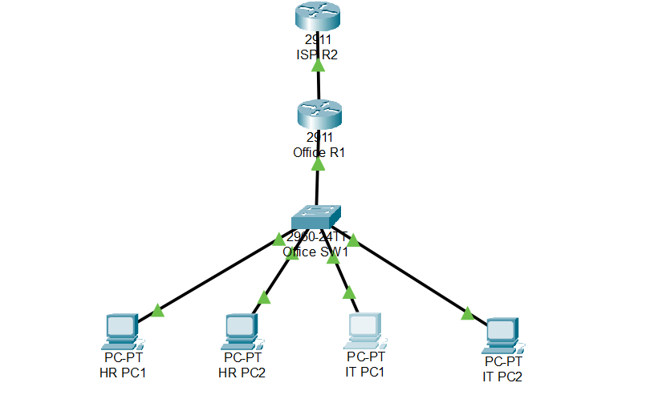
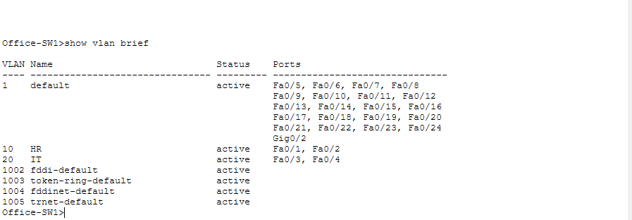

Small Office Network Design – HR and IT Departments

Project Overview:

Designed and implemented a Small Office Network Using Cisco Packet Tracer. The network separates HR and IT departments using VLANs and provides secure communication, DHCP address allocation, inter-VLAN routing and Network Address Translation (NAT).

Technologies Used

* Cisco Packet Tracer
* Cisco 2911 Router
* Cisco 2960 Switch
* VLAN
* Router-on-a-Stick
* DHCP
* NAT Overload (PAT)
* Extended Access Control Lists (ACLs)
* Static Routing

Network Topology

The network consists of:

1. 2 Cisco 2911 Routers
2. 1 Cisco 2960 Switch
3. 2 HR Computers
4. 2 IT Computers

IP Addressing

Department| VLAN |  Network          | Gateway

HR        |  10  |  192.168.10.0/24  | 192.168.10.1

IT        |  20  |  192.168.20.0/24  | 192.168.20.1

ISP link: 203.0.113.0/30

Key Configurations

1\. Created separate VLANs for HR and IT departments.

2\. Configured access ports and trunk links.

3\. Implemented Router-on-a-Stick for inter-VLAN routing.

4\. Configured DHCP pools for automatic IP allocation.

5\. Implemented NAT Overload to share an external IP address.

6\. Configured Extended ACLs to restrict communication between HR and IT.

7\. Configured static routing between the office and ISP routers.

Security Implementation

* HR computers cannot directly communicate with IT computers.
* IT computers cannot directly communicate with HR computers.
* Both departments can communicate within their own VLAN.
* Both departments can access the simulated ISP network.

Testing and Verification

The following tests were performed

* HR-to-HR connectivity – Successful
* IT-to-IT connectivity – Successful
* HR-to-IT communication – Blocked
* IT-to-HR communication – Blocked
* HR-to-ISP connectivity – Successful
* IT-to-ISP connectivity – Successful

Project Files

1. Small Office Network Design.pkt – Cisco Packet Tracer project.
2. Screenshots/ – Topology and configuration evidence.
3. Configurations/ – Router and switch configurations.

Learning Outcomes

* Understanding VLAN segmentation.
* Configuring inter-VLAN routing.
* Implementing DHCP and NAT.
* Applying ACL-based network security.
* Troubleshooting network connectivity.
* Understanding basic enterprise network architecture.

---

## Project Screenshots

### 1. Network Topology

### 2. VLAN Configuration

### 3. NAT Translation

### 4. ACL Security

